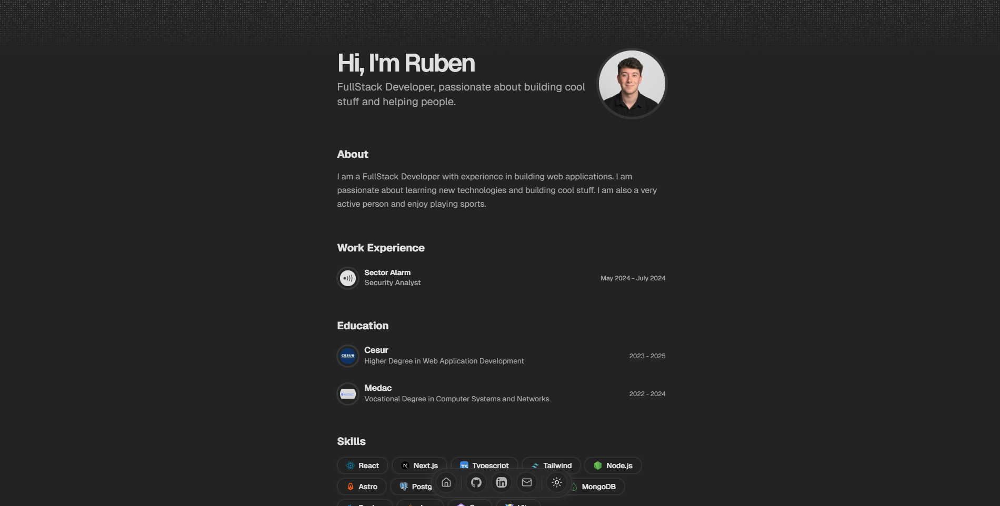
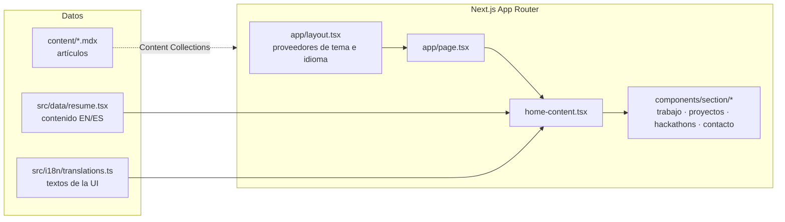

<div align="center">



# Portfolio

**Rubén Torres · FullStack Developer**

Portfolio personal, _mobile-first_, para presentar experiencia, proyectos, hackathons y contacto en **español e inglés**, con modo claro y oscuro.

[Demo](https://rubentorres.vercel.app) · [Informar de un problema](https://github.com/n3brrr/Portfolio/issues)


</div>

---

## Índice

- [Descripción](#descripción)
- [Funcionalidades](#funcionalidades)
- [Arquitectura](#arquitectura)
- [Puesta en marcha](#puesta-en-marcha)
- [Personalización](#personalización)
- [Scripts](#scripts)
- [Despliegue](#despliegue)
- [Seguridad](#seguridad)
- [Estructura del proyecto](#estructura-del-proyecto)
- [Licencia](#licencia)
- [Autor](#autor)

## Descripción

Portfolio construido con Next.js (App Router) y React 19. Todo el contenido —datos personales, experiencia, formación, proyectos, hackathons, skills y contacto— vive en un único archivo de datos tipado en dos idiomas, así que cambiar la información no requiere tocar componentes.

No tiene backend propio ni base de datos: es un sitio estático generado por Next.js que se sirve desde cualquier plataforma compatible con Next.js (pensado para Vercel).

## Funcionalidades

| Área                 | Qué ofrece                                                                                                                                 |
| -------------------- | ------------------------------------------------------------------------------------------------------------------------------------------ |
| **Contenido**        | Experiencia laboral, formación, proyectos, hackathons, skills y datos de contacto definidos en `src/data/resume.tsx`.                      |
| **Idiomas**          | Interfaz en **español e inglés** con un selector en el dock de navegación. Los textos de la UI están en `src/i18n/translations.ts`.        |
| **Tema**             | Modo claro y oscuro con `next-themes` y un selector propio.                                                                                |
| **Animaciones**      | Entradas con desenfoque (Magic UI), fondo de cuadrícula animado y scroll suave con Lenis.                                                  |
| **Contenido MDX**    | Artículos en `content/*.mdx` procesados con Content Collections, con soporte de GFM y resaltado de código.                                 |
| **Responsive**       | Diseño adaptado a móvil, tablet y escritorio.                                                                                              |
| **Metadatos**        | Metadatos de la página y imagen Open Graph generada (`src/app/opengraph-image.tsx`).                                                       |

## Arquitectura



- **Datos:** `resume.tsx` define `DATA_EN` y `DATA_ES` con la misma forma; el idioma activo decide cuál se muestra.
- **Idioma:** `src/i18n/` contiene la configuración de locales (`en` por defecto), el proveedor y los diccionarios.
- **Componentes:** `components/section/` agrupa las secciones de la página principal; `components/ui/` contiene primitivas estilo shadcn/ui y `components/magicui/` los efectos de animación.

## Puesta en marcha

### Requisitos

- Node.js 20.9 o superior (requisito de Next.js 16)
- [pnpm](https://pnpm.io/)

### Instalación

```bash
git clone https://github.com/n3brrr/Portfolio.git
cd Portfolio
pnpm install
pnpm dev   # http://localhost:3000
```

## Personalización

| Qué cambiar                         | Dónde                                                                 |
| ----------------------------------- | --------------------------------------------------------------------- |
| Datos personales, experiencia, proyectos, hackathons, skills, contacto | `src/data/resume.tsx` (versiones `DATA_EN` y `DATA_ES`)     |
| Textos de la interfaz               | `src/i18n/translations.ts`                                            |
| Idiomas disponibles                 | `src/i18n/config.ts`                                                  |
| Artículos                           | `content/*.mdx`                                                       |
| Imágenes, fuentes y logos           | `public/`                                                             |
| Metadatos y URL pública             | `src/app/layout.tsx` y el campo `url` de `src/data/resume.tsx`       |
| Cabeceras HTTP                      | `next.config.mjs`                                                     |

## Scripts

| Comando        | Descripción                                             |
| -------------- | ------------------------------------------------------- |
| `pnpm dev`     | Servidor de desarrollo de Next.js en `localhost:3000`.  |
| `pnpm build`   | Build de producción.                                    |
| `pnpm start`   | Sirve el build de producción.                           |
| `pnpm lint`    | ESLint con la configuración de Next.js.                 |
| `pnpm lint:fix`| ESLint corrigiendo automáticamente lo que pueda.        |

## Despliegue

### Vercel

El proyecto está pensado para Vercel: importa el repositorio en el panel de Vercel y se detecta Next.js automáticamente. No requiere variables de entorno.

## Seguridad

Las cabeceras HTTP se definen en `next.config.mjs` para todas las rutas:

- `X-Content-Type-Options: nosniff`
- `X-Frame-Options: DENY`
- `Referrer-Policy: strict-origin-when-cross-origin`
- `Permissions-Policy: camera=(), microphone=(), geolocation=()`

No hay formularios que guarden datos ni autenticación: el contacto se hace con enlaces `mailto:` y perfiles sociales.

¿Has encontrado un problema? Abre una [incidencia](https://github.com/n3brrr/Portfolio/issues).

## Estructura del proyecto

```text
Portfolio/
├── src/
│   ├── app/               # Rutas de Next.js (layout, página principal, 404, Open Graph)
│   ├── components/
│   │   ├── section/       # Secciones de la página (trabajo, proyectos, hackathons, contacto)
│   │   ├── magicui/       # Efectos de animación (Magic UI)
│   │   ├── ui/            # Primitivas de interfaz (estilo shadcn/ui)
│   │   └── mdx/           # Componentes para el contenido MDX
│   ├── data/              # resume.tsx: todo el contenido, en EN y ES
│   ├── i18n/              # Locales, proveedor y diccionarios de la interfaz
│   └── lib/               # Utilidades
├── content/               # Artículos en MDX (Content Collections)
├── public/                # Imágenes, logos y fuentes
├── preview/               # Captura de la página para este README
├── content-collections.ts # Configuración de la colección de artículos
└── next.config.mjs        # Configuración de Next.js y cabeceras HTTP
```

## Licencia

Distribuido bajo la [licencia MIT](./LICENSE).

## Autor

**Rubén Torres** — [@n3brrr](https://github.com/n3brrr) · [LinkedIn](https://www.linkedin.com/in/rubentorresdev/)
